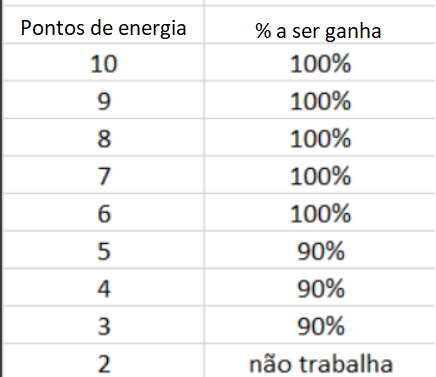
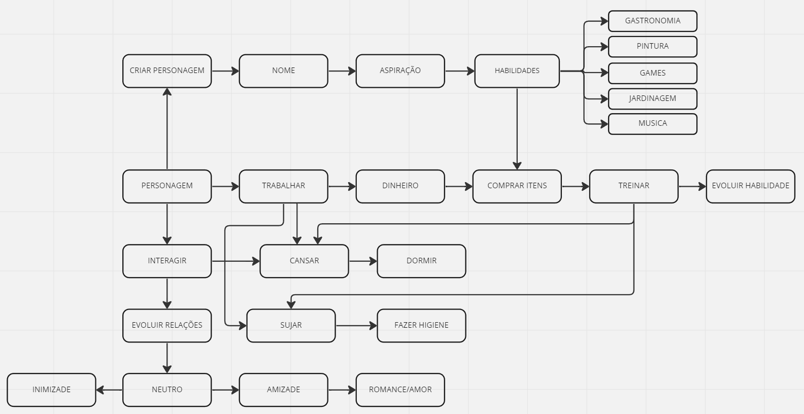

# 🎮 The Cresims
The Cresims é um jogo interativo de console feito em Node.js, inspirado em The Sims, mas totalmente adaptado para rodar no terminal.  
O objetivo principal é simular a rotina e a evolução de personagens chamados Cresims, que têm uma vida útil limitada e precisam administrar recursos como energia, higiene, relacionamentos, habilidades e dinheiro ao longo do tempo.

No jogo, o jogador pode criar múltiplos Cresims, escolher aspirações de carreira (como gastronomia, pintura, música, entre outras), treinar habilidades, conseguir empregos, interagir com outros personagens e até usar cheats para modificar o jogo. Tudo é feito por meio de menus interativos no terminal, com comandos e ações baseadas em tempo real, o que simula o passar dos dias e a vida do personagem.

🫀 REQUISITO 01 - REGRAS GERAIS

- Ao criar um personagem, o jogador deverá criar um nome para o Cresim;
- O jogador poderá criar quantos personagens quiser;
- O Cresim terá 60 “dias” de vida (3.600.000ms ou 1 hora);
    - Quando a vida do personagem chega a 0, não deve ser possível continuar jogando com ele. (Ainda é possível selecionar e jogar com outros personagens).
    - Se quiserem remover esse personagem da lista ou mantê-lo ali de histórico, fica a critério de vocês.
- O dia de um Cresim tem 60.000ms (1 minuto);
- O Cresim começará com 1.500 Cresceleons (moeda do jogo);
- O jogador deverá escolher uma aspiração para o personagem no momento da criação (poderá ser uma das 5 habilidades disponíveis: GASTRONOMIA, PINTURA, JOGOS, JARDINAGEM OU MUSICA);
    - Esse tópico servirá no requisito de **HABILIDADES**.
- Quando o Cresim estiver ocupado com alguma tarefa (dormindo, treinando, trabalhando…) o jogador não poderá jogar com esse personagem;
    - Ou seja, se é uma ação de 5.000ms, o jogador (você) não poderá interagir com o personagem durante esse tempo, esperando-o concluir a ação.
    - Você poderá, se quiser, navegar pelo jogo (voltar para o menu inicial, olhar as infos, etc) ou jogar com outro personagem. (isso não é pré-requisito, você pode só deixar o tempo rolando e o jogo travado)

🔋 REQUISITO 02 - ENERGIA

- O Cresim tem 32 pontos de energia máximos e iniciará o jogo com a carga completa;
- Deve ser implementado a possibilidade de um cresim dormir para recuperar pontos de energia. O Cresim ganha 4 pontos de energia a cada 5.000ms dormidos, e ganha 2 pontos bônus a cada 5.000ms a mais que dormir direto, ou seja, se dormir 10.000ms, ganha 8 pontos + 2;
- O Cresim não deve ficar com os pontos de energia negativados, e nem passar dos pontos máximos de energia (32 pontos)
- Quando o Cresim estiver com 0 pontos de energia, ele não poderá realizar mais nenhuma ação a não ser dormir.
    OBS: A implementação de como funcionará a dinâmica de dormir fica a critério de vocês. Alguns exemplos:

        - Ao dormir, o usuário é obrigado a dormir até restaurar a energia por completo.
        - O usuário ter opções predefinidas de tempo para dormir como por exemplo, tirar uma soneca, dormir completamente, etc..
        - O usuário escolher quanto tempo pode dormir ou quanto de energia quer recuperar.
        O funcionamento em si é de escolha livre, o importante é se atentar a fórmula de cálculo para descontar o tempo de vida necessário.

🎭 REQUISITO 03 - HABILIDADES E ASPIRAÇÕES 

- O Cresim pode evoluir as habilidades de gastronomia, pintura, jogos, jardinagem e musica;
- Para isso, ele deve comprar itens que vão permiti-lo praticar e acrescentar pontos de habilidade;
    
[ITENS-DE-HABILIDADE]
Link para requisição: https://luanna88.github.io/The-Cresim/assets/itens-habilidades.json

- Cada ciclo de treino dura 8.000ms. Quando completo, ele ganha os pontos de habilidade do item que ele utilizou;
- Caso a habilidade que o Cresim esteja exercitando seja sua aspiração, ele poderá acrescentar +1 ponto de habilidade a cada ciclo de treino;
- Em um ciclo de treino, o Cresim perde 4 pontos de energia;
- O Cresim não deve iniciar um treino se não ter pontos de energia suficientes;
- Na medida em que vai evoluindo nas habilidades, o nível de habilidade e salário vão aumentando;
- Cada habilidade tem 3 níveis: JUNIOR, PLENO E SÊNIOR:
    - O Cresim iniciará no nível JUNIOR, com 0 pontos de habilidade;
    - Cada nível tem uma quantidade de pontos de habilidade para alcançar. Quando o Cresim alcança os pontos de habilidade requeridos, ele passa para o próximo nível.
    
🍼 **JUNIOR**

0 - 16 pontos

🔥 **PLENO**

17 - 26 pontos

👑 **SENIOR**

> 26 pontos

💼 REQUISITO 04 - TRABALHO

[EMPREGOS]
Link para requisição: https://luanna88.github.io/The-Cresim/assets/empregos.json

- A jornada de trabalho padrão de um Cresim é de 20.000ms;
- O Cresim deve perder 10 pontos de energia na jornada de trabalho padrão;
- Se um Cresim começar a trabalhar com 10 pontos de energia ou menos, ele deve ganhar -10% Cresceleons a cada ponto de energia igual ou menor que 5;
- O Cresim só pode trabalhar até 2 pontos de energia, ou seja, a jornada de trabalho deve ser recalculada, juntamente ao salário, e ele deve parar antes e receber equivalente;
    OBS: Supondo que o Cresim esteja com 10 pontos de energia e ganhe 160 Cresceleons por dia de trabalho:

        cargaDeTrabalho / pontosDeEnergiaPorJornada = msParaCadaPontoDeEnergia
        $20.000 / 10 = 2.000ms
        $
        Cada ponto de energia são 2.000ms de trabalho

        pontosDeEnergiaAtuais - pontosDeEnergiaMinimo = pontosDeEnergiaParaGastar * msParaCadaPontoDeEnergia = maximoDeTempoParaTrabalhar
        $10 - 2 = 8 * 2.000 = 16.000ms
        $
        O Cresim vai poder trabalhar até 16.000ms

        cargaDeTrabalho / salarioDiario = tempoEmMsParaCadaCresceleon
        $20.000 / 160 = 125ms
        $
        A cada 125ms o Cresim ganha 1 Cresceleon

        msParaCadaPontoDeEnergia / tempoEmMsParaCadaCresceleon = cresceleonParaCadaPontoDeEnergia
        $2.000ms / 125ms = 16 cresceleons
        $
        A cada 2.000ms o Cresim ganha 16 Cresceleons

        pontosDeEnergiaParaDesconto - pontosDeEnergiaMinimo = pontosDeEnergiaParaRecalculo
        $5 - 2 = 3
        $
        3 pontos de energia servirão para o recálculo (desconto de 10%) do salário do Cresim

        pontosDeEnergiaParaRecalculo * (cresceleonParaCadaPontoDeEnergia - porcentagemDeDesconto) = recalculoSalarioCresimCansado
        $3 * (16 - 10porcento) = 43,2$
        O Cresim receberá 43,2 Cresceleons referente ao tempo em que trabalhou cansado

        pontosDeEnergiaAtuais - pontosDeEnergiaParaDesconto = pontosDeEnergiaCresimDescansado
        $10 - 5 = 5$
        O Cresim ainda tem 5 pontos de energia descansado para trabalhar

        pontosDeEnergiaCresimDescansado * cresceleonParaCadaPontoDeEnergia = salarioCresimDescansado
        $5 * 16 = 80 cresceleons$
        O Cresim receberá 80 Cresceleons referente ao tempo em que trabalhou descansado

        recalculoSalarioCresimCansado + salarioCresimDescansado = salarioTotal
        $43,2 + 80 = 123,2$
        O Cresim receberá 123,2 Cresceleons recalculados ao fim de um turno de trabalho
    
    O Cresim não deve conseguir COMEÇAR a trabalhar com os pontos de energia menores ou iguais a 4;
    ATENÇÃO: Não esqueça que os níveis de habilidade JUNIOR, PLENO e SENIOR em determinada categoria, define o nível do Cresim no trabalho de mesma categoria. Por exemplo, se ele for SENIOR em jogos e escolher um emprego da categoria de Jogos, então ele ganhará salário de SENIOR, mas se ele escolher um emprego em gastronomia, mesmo sendo SENIOR em jogos, ele ganhará o salario referente ao nível dele na habilidade de gastronomia.

💑 REQUISITO 05 - RELACIONAMENTOS

[RELACIONAMENTOS]
Link para requisição: https://luanna88.github.io/The-Cresim/assets/interacoes.json

- Um Cresim pode se comunicar com outro;
- Ao comunicar-se, o relacionamento dos Cresims vai evoluindo de acordo com os pontos de cada tipo de interação;
- Cada nível de relacionamento desbloqueia novas interações para os Cresims;
- Os níveis de relacionamento consistem em:
💔 INIMIZADE 

< 0 pontos

 🌱 NEUTRO 

0 - 10 pontos

 🍻 AMIZADE 

11 - 25 pontos

 ❤️‍🔥 AMOR 

> 25 pontos

- O Cresim vai iniciar com apenas as interações NEUTRAS disponíveis, e de acordo de como ele ir  evoluindo, outras categorias de interações vão liberando, assim surgindo mais opções para que os Cresims interajam;
    - Se o Cresim evoluir do NEUTRO para AMIZADE, então ele terá as interações de NEUTRO e AMIZADE; se ele evoluir para amor, então ele terá as categorias NEUTRO, AMIZADE E AMOR; se ele evoluir para INIMIZADE, então ele terá NEUTRO e INIMIZADE.
- O Cresim perde pontos de energia referente a cada interação;
    - O outro Cresim envolvido na interação gasta METADE dos pontos de energia da interação:
        - Caso a metade dos pontos de energia seja um número quebrado, poderá ser arredondado para cima.
- O tempo gasto em cada interação é o numero de pontos de energia (que consta no json de interações) multiplicado por 2000ms;
    - Ambos os Cresims envolvidos gastam o mesmo tempo.
- Os relacionamentos entre os Cresims são bidirecionais. Por exemplo, se você estiver jogando com o personagem **João** e alcançar 11 pontos (amizade) com **Sofia**, ao alternar para a personagem **Sofia**, ela também terá 11 pontos (amizade) com **João**.

🚿 REQUISITO 06 - HIGIENE 

- O Cresim tem 28 pontos de higiene máximos e iniciará o jogo com a carga completa;
- O Cresim deve perder 4 pontos de higiene quando trabalhar um turno inteiro;
    - Caso ele não trabalhe um turno inteiro, deve ser feito o cálculo para descontar os pontos de higiene equivalente. (opcional)
    - Se o item anterior não for atendido, pode-se descontar apenas os 4 pontos de higiene para qualquer tempo trabalhado.
- O Cresim deve perder 2 pontos de higiene a cada ciclo de treino;
- O Cresim deve poder tomar banho;
    - Quando o Cresim tomar banho, deve ser descontado 10 Cresceleons;
    - O banho do Cresim leva 3.000ms para finalizar;
    - Ao tomar banho, ele recupera 100% da higiene.
- A higiene do Cresim não pode ficar menor que 4: caso isso aconteça, seu desempenho no trabalho será reduzido, ou seja, deve ser descontado 10% do salário do dia do Cresim.
    - A verificação dos pontos de higiene para recálculo do salário, deve ser feita já descontando os 4 pontos perdidos do trabalho. Exemplo: se o Cresim iniciar com 6 pontos e ao final da jornada ficar com 2 pontos, então deve ser feito o desconto.
- A higiene do Cresim não deve ficar negativa.
    - Deve ser checado se os pontos de higiene do Cresim são suficientes para a ação, se não for, não deverá ser possível iniciar a ação.

### 🤖 REQUISITO 07 - CHEATS

- Durante qualquer momento onde o jogador estiver realizando algum input de dado no jogo ele poderá realizar um cheat.
    - Esse cheat é um texto pré-definido que irá habilitar certas recompensas para o personagem selecionado atualmente;
    - Caso o jogador insira um comando de cheat, a aplicação deve processar o cheat imediatamente e continuar o jogo a partir do ponto em que parou;
    - Quando usados numa tela onde não há um Cresim selecionado (como por exemplo algum menu principal ou tela de seleção de Cresim) o cheat não fará nada.

### Cheats disponíveis:

- **SORTENAVIDA**
    - Aumenta a quantidade de cresceleons (moeda do jogo) em 1.000.
- **DEITADONAREDE**
    - Aumenta a energia do Cresim em 10 pontos.
- **TERAPIA**
    - Aumenta os pontos de relacionamento do Cresim com todos os outros personagens em 5.
- **DESODORANTE**
    - Aumenta os pontos de higiene do Cresim em 15.
- **WHEYPROTEIN**
    - Aumenta a vida do Cresim em 100.000ms.
- **SINUSITE**
    - Remove todo o tempo de vida do Cresim. ☠️.

Duvidas comuns

### Quando a regra do cansaço valerá?

Quando o Cresim começar a trabalhar com 10 pontos de energia ou menos, só começará a descontar do salário com 5 pontos de energia ou menos. Ou seja, se o Cresim começar a trabalhar com 11 pontos de energia, a única coisa que deverá ser feita é o recálculo do tempo de trabalho e do salário condizente com o tempo em que ele trabalhou, já que ele não pode trabalhar com 2 pontos ou menos.

### O tempo de vida começa a contar a partir do momento que o Cresim é criado?

O tempo de vida é descontado com as ações! Por isso cada ação tem um tempo em ms. Enquanto o tempo de vida é descontado, o jogador não poderá jogar com esse personagem. Ou seja, se é uma ação de 5.000ms, o jogador (você) não poderá interagir com o personagem durante esse tempo, esperando-o concluir a ação.

Observações e dicas
É de livre escolha caso queira fazer alguma implementação de fazer o tempo do Cresim passar mais rápido. Por exemplo: ao dormir 10.000ms e decidir passar o tempo em 4x e levar apenas 2.500ms, esse tempo será transparente apenas para o JOGADOR, ou seja, para você, para que a jogabilidade fique mais rápida, porém o Cresim ainda deverá ter os 10.000ms descontados de sua vida.

GitHub Pages: https://luanna88.github.io/The-Cresim/
